# 💼 Curriculum Vitae

## Preview CV

## Tentang Project

Website Curriculum Vitae (CV) yang dibuat menggunakan HTML dan CSS untuk tugas mata kuliah Pemrograman Web.

## Teknologi yang Digunakan

- HTML5
- CSS3

## Struktur Project

- `index.html` : Struktur halaman CV.
- `style.css` : Desain dan tampilan CV.
- `img/` : Folder aset gambar.
- `README.md` : Dokumentasi project.

# 👋 Hi, I'm DappSheesshh

### 💻 Informatics Engineering Student

*Learning • Building • Exploring Technology*

---

## 👨‍💻 About Me

I'm an Informatics Engineering student who is passionate about
programming, technology, and software development.

Currently, I'm learning programming fundamentals, web development,
networking, and various technologies through university projects
and personal experiments.

I enjoy turning ideas into working projects and continuously
improving my technical skills.

---

## 💻 Core Tech Stack

## 🧰 Other Tech Stack

---

## 📊 GitHub Stats

---

## 🔥 GitHub Streak

---

## 🛠️ Tools

---

## 🌐 Connect With Me

---

### 🚀 Thanks for visiting my profile!

⭐ Feel free to explore my repositories.

