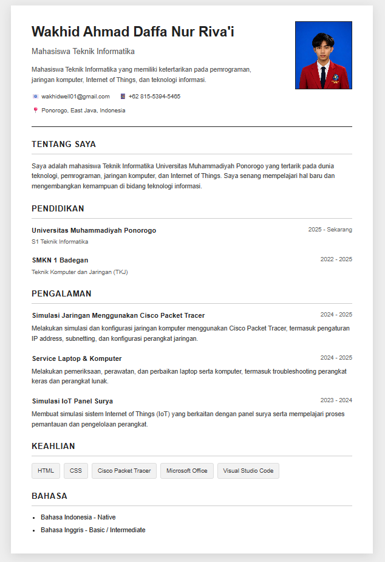

# 💼 Curriculum Vitae

## Preview CV

## Tentang Project

Website Curriculum Vitae (CV) yang dibuat menggunakan HTML dan CSS untuk tugas mata kuliah Pemrograman Web.

## Teknologi yang Digunakan

- HTML5
- CSS3

## Struktur Project

- `index.html` : Struktur halaman CV.
- `style.css` : Desain dan tampilan CV.
- `img/` : Folder aset gambar.
- `README.md` : Dokumentasi project.
